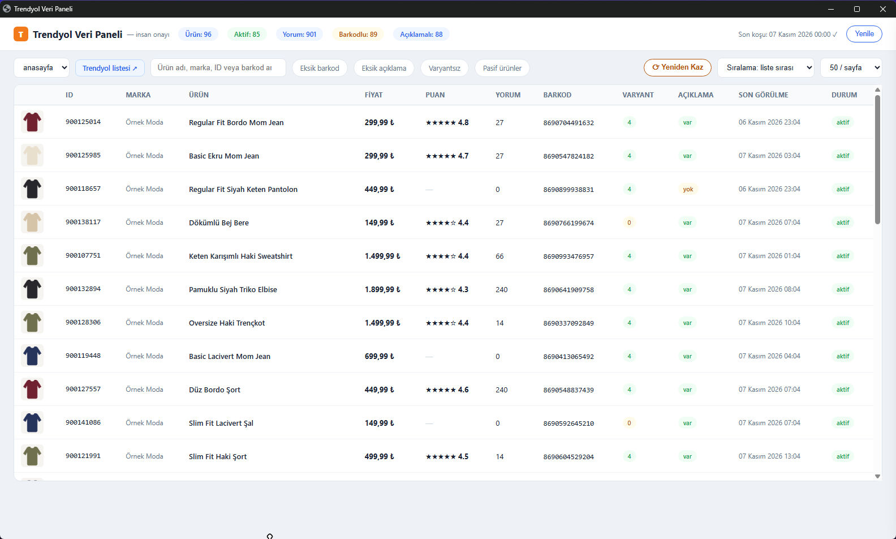
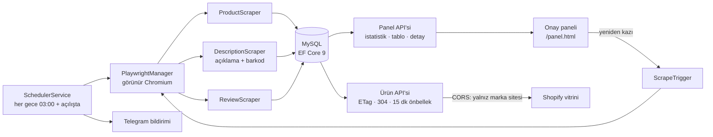
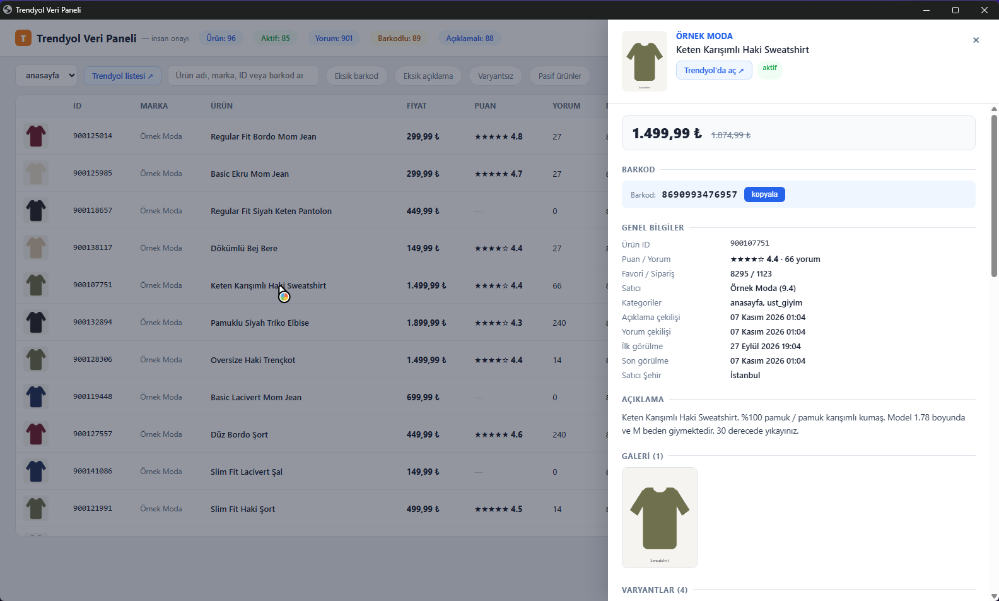
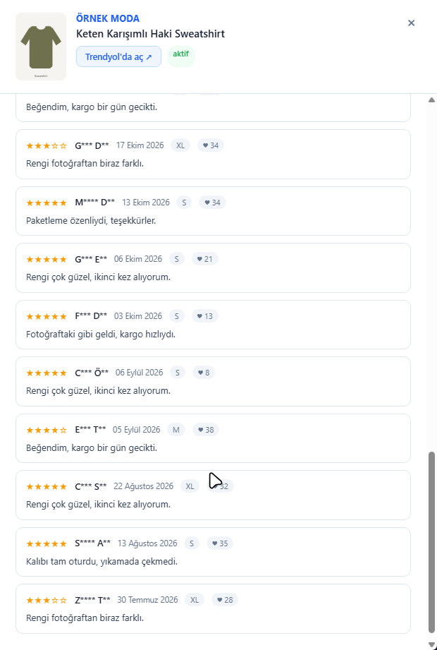

# Trendyol Scraper — Ürün ve Yorum Verisi Toplama Servisi

**Trendyol satıcı mağazasındaki ürünleri, açıklamaları, varyantları ve müşteri yorumlarını her gece otomatik toplayan; bunları MySQL'de saklayıp markanın kendi web sitesine önbellekli JSON API olarak sunan arka plan servisi.**

-lightgrey)

> **30 saniyede:**
> - **Problem:** Markanın Trendyol'da biriken müşteri yorumları ve zengin ürün içeriği, kendi web sitesinde (Shopify) görünmüyordu — sosyal kanıt pazaryerinde kalıyordu.
> - **Çözüm:** Zamanlanmış Playwright kazıyıcısı verileri MySQL'e yazar; ASP.NET Core API, siteye ETag/304 destekli, CORS korumalı JSON sunar; insan onay paneli ile veri kontrol edilir.
> - **Kanıt:** Tek tıkla kurulum sihirbazı (MySQL bağlantısı, güvenlik duvarı, otomatik başlatma), self-contained dağıtım, Telegram bildirimleri.

  

<b>English summary</b>

A .NET 9 background service that nightly scrapes a Trendyol seller's catalogue — products, descriptions/barcodes, variants, categories and reviews — with Playwright, stores it in MySQL via EF Core, and serves it as a cached JSON API (ETag / 304, CORS-restricted to the brand's storefront) so the brand's own Shopify site can display Trendyol reviews. Includes a human-review web panel, manual re-scrape trigger, price history, Telegram notifications and a one-file installer that writes config, opens the firewall port and registers auto-start. Source is private.

---

## Problem

Pazaryerinde toplanan yorumlar, satın alma kararında en güçlü sinyallerden biridir; ancak bu yorumlar markanın kendi sitesine taşınamıyordu. Elle kopyalamak sürdürülebilir değildi ve ürün/varyant/barkod eşleşmesinin doğru kurulması gerekiyordu.

## Çözüm

- **Veri modeli:** Ürün, varyant, kategori, özellik, satıcı, yorum, **fiyat geçmişi** ve kazıma çalıştırmaları (`ScrapeRun`).
- **Vitrin API'si:** Ürün ID'si, barkod veya kategoriye göre sorgu; yorumlu/yorumsuz (compact) yanıt; Türkçe tarih biçimlendirme.
- **Onay paneli:** Toplanan verinin insan tarafından gözden geçirilmesi, istatistikler ve seçili ürünlerin yeniden kazınması.
- **JSON içe aktarım:** Önceki veri kaynaklarından geçiş için içe aktarıcı.

## Mühendislik kararları

- **Neden görünür tarayıcı?** Hedef sayfaların scriptleri headless modda çalışmıyordu; çözüm, otomatik oturum açma ile görünür Chromium ve gece çalıştırma penceresi.
- **HTTP önbellekleme doğru yapıldı.** Ürün `UpdatedAt` ve en son yorum zamanından üretilen ETag ile koşullu istekler 304 döner; site trafiği veritabanını yormaz.
- **Dar CORS politikası.** Yalnızca marka alan adlarından, yalnızca `GET/OPTIONS`.
- **Kurulum, son kullanıcı için.** Tek `Setup.exe`: MySQL bilgilerini sorar ve `appsettings.json` yazar, güvenlik duvarı kuralı açar, Chromium indirir, Görev Zamanlayıcı'ya otomatik başlatma ekler; yeniden kurulumda mevcut ayarları korur. Runtime gerektirmeyen self-contained yayın.
- **Bağımlılık enjeksiyonu ve kapsamlar.** Kazıyıcılar scoped, tarayıcı yöneticisi singleton — tek tarayıcı, çok iş.

## Teknoloji yığını

| Alan | Teknolojiler |
|---|---|
| Dil / Runtime | C#, .NET 9 (self-contained) |
| Web | ASP.NET Core Minimal API, statik HTML panel |
| Kazıma | Microsoft Playwright (Chromium) |
| Veri | EF Core 9 + Pomelo MySQL (MySQL 8) |
| Loglama | Serilog (konsol + dosya) |
| Bildirim | Telegram |
| Dağıtım | Kurulum sihirbazı, PowerShell, Windows Görev Zamanlayıcı |

## Ekran görüntüleri

| | |
|---|---|
|  **Ürün detayı: barkod, fiyat, açıklama** |  **Kazınan yorumlar (mağazaya giden veri)** |

> Görsellerdeki ürünler, fiyatlar, barkodlar, yorumlar ve kullanıcı adları kurgusaldır. Uygulama, izole bir demo kopyasında ayrı bir yerel veritabanıyla ve kazıma devre dışı bırakılarak çalıştırılmıştır; Trendyol'a hiçbir istek atılmamıştır. Ürün görselleri demo için üretilmiş basit çizimlerdir.

## Rolüm

Tek geliştirici: veri modeli, kazıyıcılar, API, önbellekleme, kurulum sihirbazı ve vitrin entegrasyonu.

## Kaynak kodu hakkında

Bu depo bir **vaka çalışmasıdır**; kod ticari bir işletmeye ait olduğu için paylaşılmamaktadır. Görüşmede canlı demo ve kod incelemesi yapabilirim.

📫 **İletişim:** [GitHub profilim](https://github.com/furkan-karapinar)
